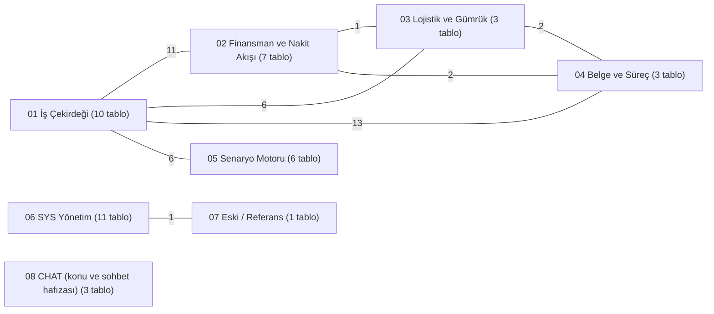
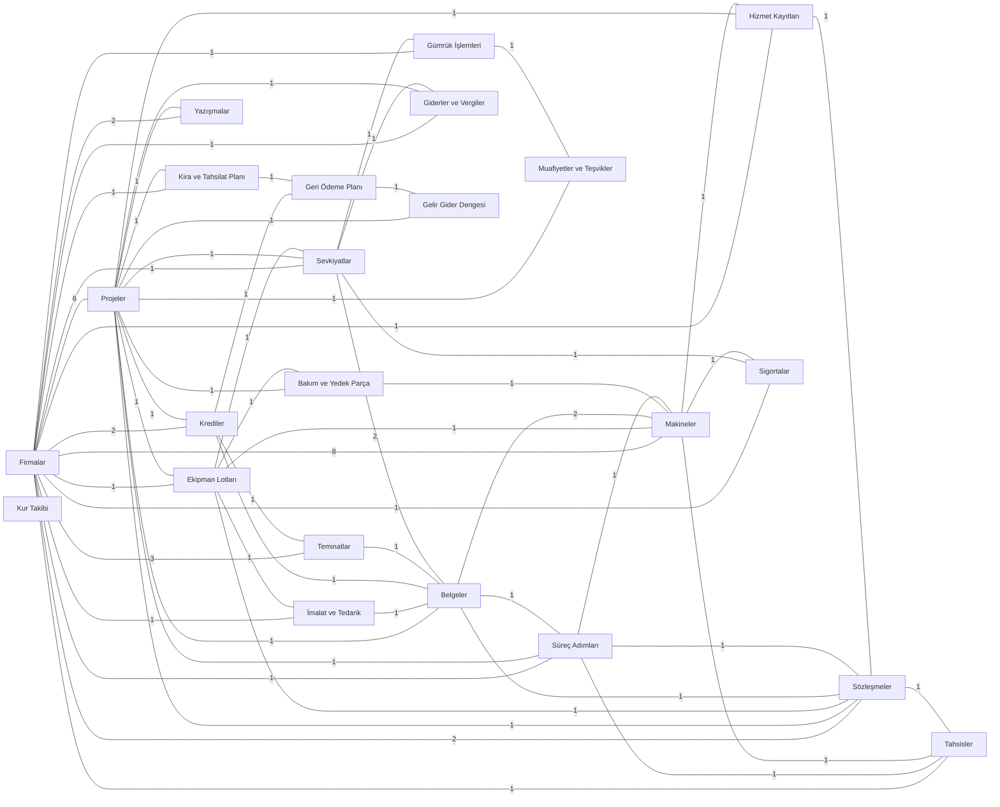
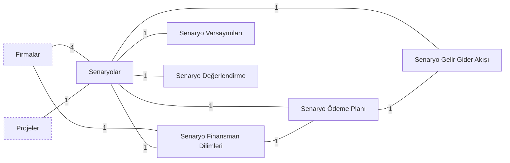
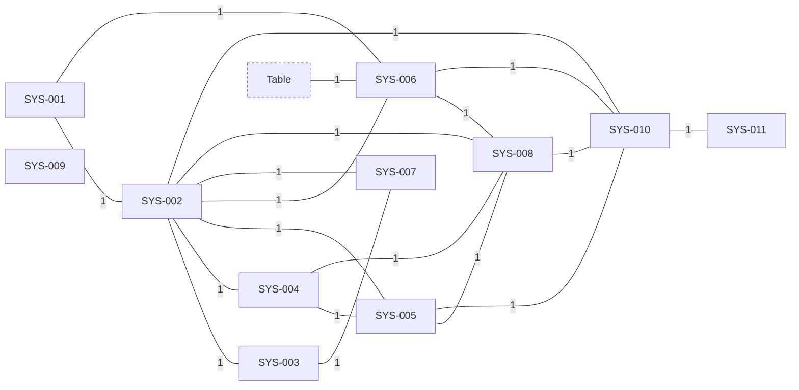

# Tablo İlişki Haritası

> Otomatik üretildi (`tools/build_schema_docs.py`), kaynak: canlı şema 2026-11-08T16:01:05+03:00. Kenar etiketi = iki tablo arasındaki ilişki alanı sayısı (çift yönlü alanlar tek sayılır).

## 1. Grup düzeyinde harita

## 2. Operasyonel tablolar (grup 01-04)

## 3. Senaryo motoru (grup 05) ve bağlandığı tablolar

## 4. SYS yönetim tabloları (grup 06)

## 5. Tablo -> bağlı olduğu tablolar

Parantez içindeki sayı, o tablodan hedefe giden ilişki alanı sayısıdır. Hızlı etki analizi için kullanın: bir tabloyu değiştirmeden önce buradaki komşulara bakın.

| Tablo | Bağlantılı tablolar |
|---|---|
| Firmalar | Ekipman Lotları (1), Giderler ve Vergiler (1), Gümrük İşlemleri (1), Hizmet Kayıtları (1), Kira ve Tahsilat Planı (1), Krediler (2), Makineler (8), Projeler (6), Senaryo Finansman Dilimleri (1), Senaryolar (4), Sevkiyatlar (1), Sigortalar (1), Sözleşmeler (2), Süreç Adımları (1), Tahsisler (1), Teminatlar (3), Yazışmalar (2), İmalat ve Tedarik (1) |
| Projeler | Bakım ve Yedek Parça (1), Belgeler (1), Ekipman Lotları (1), Firmalar (6), Gelir Gider Dengesi (1), Giderler ve Vergiler (1), Hizmet Kayıtları (1), Kira ve Tahsilat Planı (1), Krediler (1), Muafiyetler ve Teşvikler (1), Senaryolar (1), Sevkiyatlar (1), Sözleşmeler (1), Süreç Adımları (1), Yazışmalar (1) |
| Ekipman Lotları | Bakım ve Yedek Parça (1), Firmalar (1), Makineler (1), Projeler (1), Sevkiyatlar (1), Sözleşmeler (1), İmalat ve Tedarik (1) |
| İmalat ve Tedarik | Belgeler (1), Ekipman Lotları (1), Firmalar (1) |
| Bakım ve Yedek Parça | Ekipman Lotları (1), Makineler (1), Projeler (1) |
| Makineler | Bakım ve Yedek Parça (1), Belgeler (2), Ekipman Lotları (1), Firmalar (8), Hizmet Kayıtları (1), Sigortalar (1), Süreç Adımları (1), Tahsisler (1) |
| Hizmet Kayıtları | Firmalar (1), Makineler (1), Projeler (1), Sözleşmeler (1) |
| Sözleşmeler | Belgeler (1), Ekipman Lotları (1), Firmalar (2), Hizmet Kayıtları (1), Projeler (1), Sözleşmeler (kendine) (1), Süreç Adımları (1), Tahsisler (1) |
| Tahsisler | Firmalar (1), Makineler (1), Sözleşmeler (1), Süreç Adımları (1) |
| Sigortalar | Firmalar (1), Makineler (1), Sevkiyatlar (1) |
| Krediler | Belgeler (1), Firmalar (2), Geri Ödeme Planı (1), Projeler (1), Teminatlar (1) |
| Teminatlar | Belgeler (1), Firmalar (3), Krediler (1) |
| Kira ve Tahsilat Planı | Firmalar (1), Geri Ödeme Planı (1), Projeler (1) |
| Giderler ve Vergiler | Firmalar (1), Projeler (1), Sevkiyatlar (1) |
| Geri Ödeme Planı | Gelir Gider Dengesi (1), Kira ve Tahsilat Planı (1), Krediler (1) |
| Gelir Gider Dengesi | Geri Ödeme Planı (1), Projeler (1) |
| Kur Takibi | - |
| Sevkiyatlar | Belgeler (2), Ekipman Lotları (1), Firmalar (1), Giderler ve Vergiler (1), Gümrük İşlemleri (1), Projeler (1), Sigortalar (1) |
| Gümrük İşlemleri | Firmalar (1), Muafiyetler ve Teşvikler (1), Sevkiyatlar (1) |
| Muafiyetler ve Teşvikler | Gümrük İşlemleri (1), Projeler (1) |
| Belgeler | Krediler (1), Makineler (2), Projeler (1), Sevkiyatlar (2), Sözleşmeler (1), Süreç Adımları (1), Teminatlar (1), İmalat ve Tedarik (1) |
| Süreç Adımları | Belgeler (1), Firmalar (1), Makineler (1), Projeler (1), Sözleşmeler (1), Tahsisler (1) |
| Yazışmalar | Firmalar (2), Projeler (1) |
| Senaryolar | Firmalar (4), Projeler (1), Senaryo Değerlendirme (1), Senaryo Finansman Dilimleri (1), Senaryo Gelir Gider Akışı (1), Senaryo Varsayımları (1), Senaryo Ödeme Planı (1) |
| Senaryo Finansman Dilimleri | Firmalar (1), Senaryo Ödeme Planı (1), Senaryolar (1) |
| Senaryo Ödeme Planı | Senaryo Finansman Dilimleri (1), Senaryo Gelir Gider Akışı (1), Senaryolar (1) |
| Senaryo Varsayımları | Senaryolar (1) |
| Senaryo Değerlendirme | Senaryolar (1) |
| Senaryo Gelir Gider Akışı | Senaryo Ödeme Planı (1), Senaryolar (1) |
| SYS-001 | SYS-002 (1), SYS-006 (1) |
| SYS-002 | SYS-001 (1), SYS-003 (1), SYS-004 (1), SYS-005 (1), SYS-006 (1), SYS-007 (1), SYS-008 (1), SYS-010 (1) |
| SYS-003 | SYS-002 (1), SYS-007 (1) |
| SYS-004 | SYS-002 (1), SYS-005 (1), SYS-008 (1) |
| SYS-005 | SYS-002 (1), SYS-004 (1), SYS-008 (1), SYS-010 (1) |
| SYS-006 | SYS-001 (1), SYS-002 (1), SYS-008 (1), SYS-010 (1), Table (1) |
| SYS-007 | SYS-002 (1), SYS-003 (1) |
| SYS-008 | SYS-002 (1), SYS-004 (1), SYS-005 (1), SYS-006 (1), SYS-010 (1) |
| SYS-009 | - |
| SYS-010 | SYS-002 (1), SYS-005 (1), SYS-006 (1), SYS-008 (1), SYS-011 (1) |
| SYS-011 | SYS-010 (1) |
| Table | SYS-006 (1) |
| CHAT-001 \| Konular | CHAT-002 \| Notlar (1), CHAT-003 \| Sorular (1) |
| CHAT-002 \| Notlar | CHAT-001 \| Konular (1) |
| CHAT-003 \| Sorular | CHAT-001 \| Konular (1) |

## 6. Firmalar rol alanları (mülkiyet ve sorumluluk zinciri)

Aşağıdaki alanların hepsi **Firmalar** tablosuna bağlanır; hukuki malik, fiili kullanıcı, ithalatçı, tescil sahibi gibi rolleri ayırır.

| Tablo | Alan |
|---|---|
| Projeler | İthalatçı Firma, Gümrük Beyan Sahibi, Fatura Alıcısı, İlk Hukuki Malik, Nihai Hedef Malik, Tescil Sahibi |
| Ekipman Lotları | Tedarikçi |
| İmalat ve Tedarik | İmalatçı |
| Krediler | Kreditör, Borçlu |
| Teminatlar | Veren, Lehtar, Bildirim Yapılan Taraf |
| Sevkiyatlar | Taşıyıcı |
| Gümrük İşlemleri | Gümrük Müşaviri |
| Kira ve Tahsilat Planı | Kiracı |
| Giderler ve Vergiler | Firma |
| Süreç Adımları | Sorumlu Firma |
| Yazışmalar | Kimden Firma, Kime Firma |
| Makineler | Saha / Kiracı, Hukuki Malik, Fiili Kullanıcı, İthalatçı Firma, Gümrük Beyan Sahibi, Tescil Sahibi, Zilyet / Teslim Alan, Hedef Hukuki Malik |
| Hizmet Kayıtları | Firma |
| Sözleşmeler | Veren / Satıcı Taraf, Alan / Alıcı Taraf |
| Tahsisler | Kullanan Firma |
| Sigortalar | Sigorta Şirketi |
| Senaryolar | İthalatçı Firma, Gümrük Beyan Sahibi, Hukuki Malik, Fiili Kullanıcı |
| Senaryo Finansman Dilimleri | Finansör |

## 7. Kendine bağlanan alanlar

- Sözleşmeler: `Ana Sözleşme`
